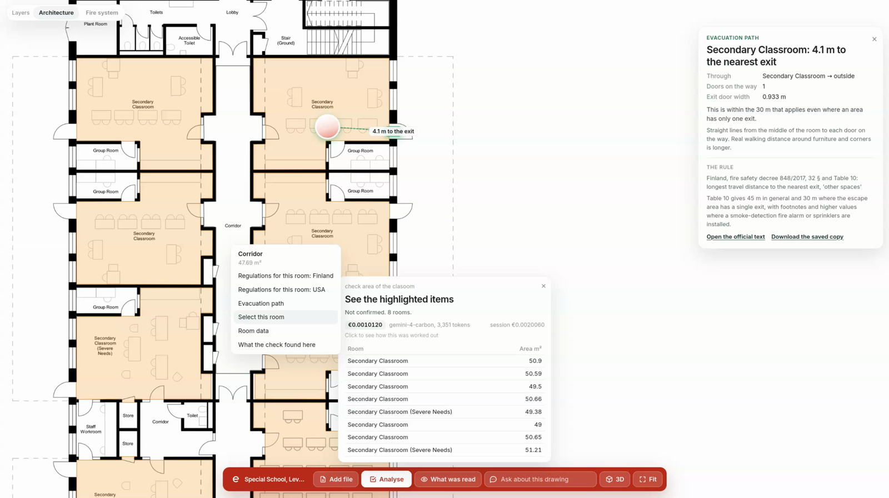
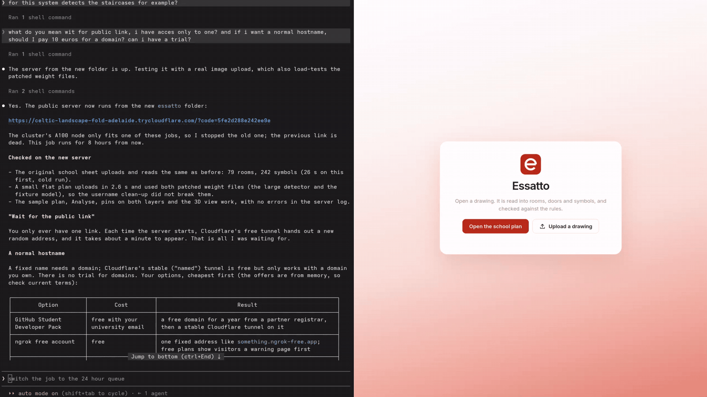
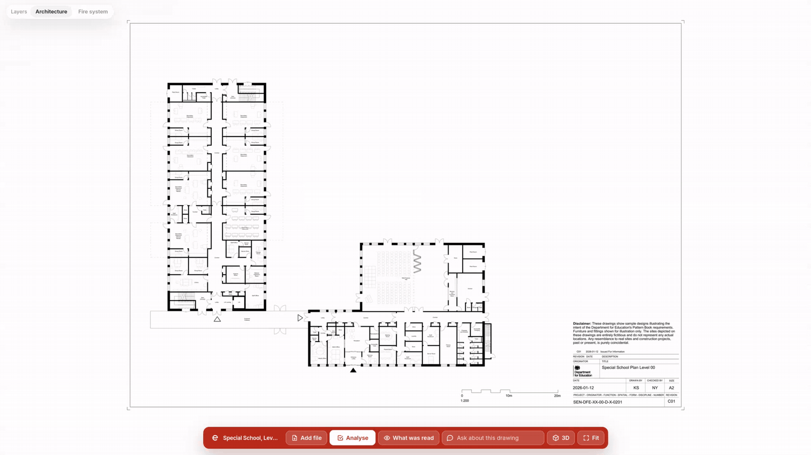
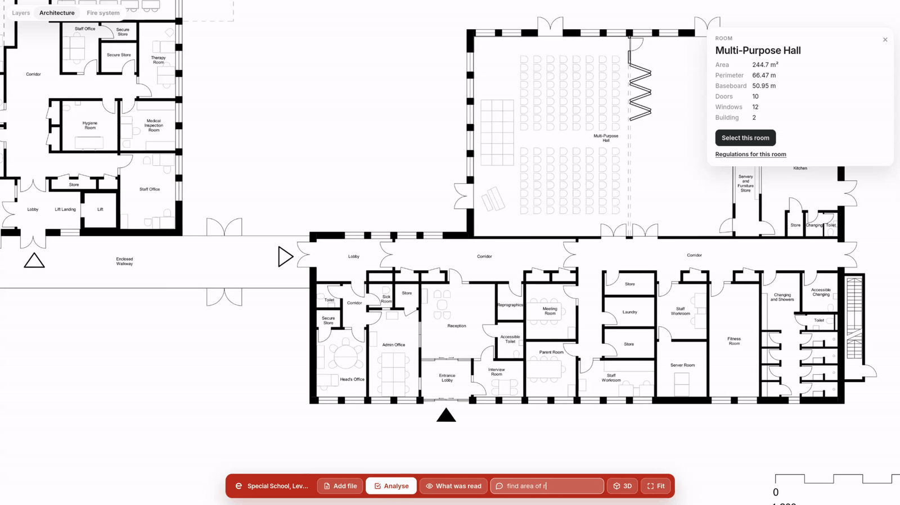
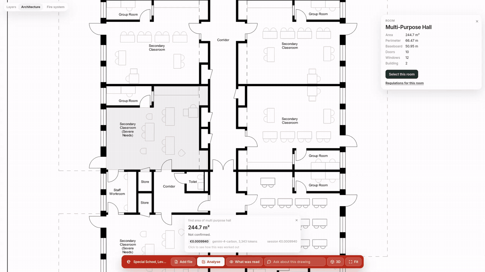
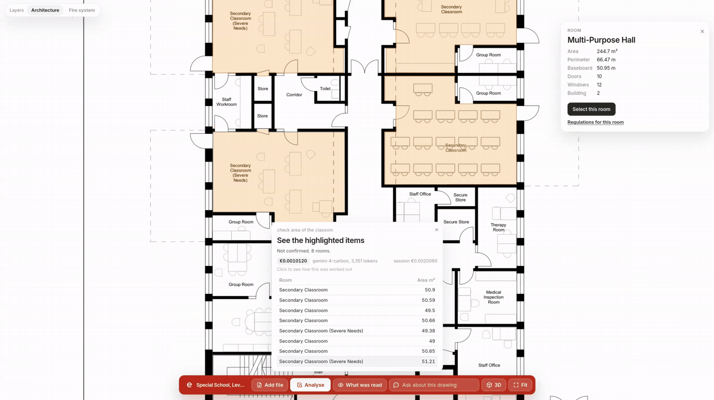
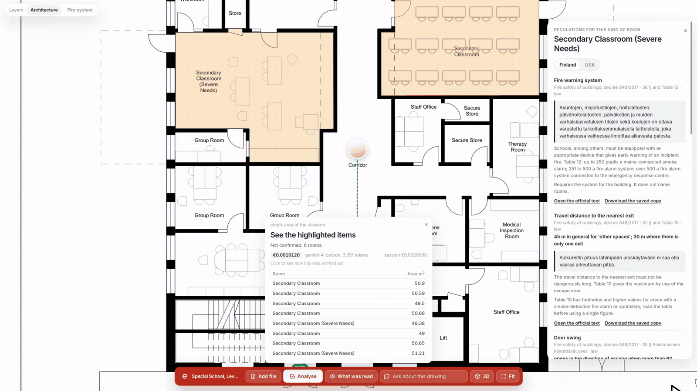

# Essatto: answers about construction drawings that can be checked

Essatto reads a drawing or a building model, answers quantity questions about it, and checks it against written
rules. Three principles shaped every part:

1. **Code computes every number.** A language model may read the question or look at a picture, but it never
   produces a quantity. The same file and question give the same answer every time.
2. **Every answer shows where it came from.** The rooms, doors or table rows used are marked on the drawing, and
   the steps are listed.
3. **A refusal with a reason is better than a guess.** If the drawing does not hold what was asked, the answer
   says so and says why.

Built for the Junction challenge "Make Blueprints Talk" (Stoa). This file describes every approach used and what
was measured. `ENGINE.md` is the developer guide to the engine (`bp/`); `RECIPES.md` is the list of ready-made
calculations; `memory/README.md` covers the solved-question memory.

```
file ── read by format ──> entities with their source ──┐
                                                         ├─ plan run by code ──> value, steps, marks on the drawing
question ── rules ─ (memory) ─ small model ─ large model ┘        trust label, cost in euros
            cheapest first; each step only if the one before could not read the question
```

## Demo



🎬 **[Watch the 1-minute demo](docs/media/essatto-demo.mp4)**

**Open a drawing.** Start from the sample school plan or upload your own; it is read into rooms, doors and symbols.



**Room data and selection.** Click a room for its area, perimeter, baseboard, doors, windows and seats;
shift-click several rooms for a table with totals.



**Ask about the drawing.** "find area of multi purpose hall": the answer is marked on the plan, with its cost in
euros and the session total.



**Check across the plan.** "check area of the classroom": every matching room is highlighted and listed.



**Evacuation path.** Distance to the nearest exit, doors on the way and exit width, against Finland's fire safety
decree 848/2017, 32 § and Table 10.



**Official text.** Each rule links to the official source on Finlex and to a saved copy.



## Contents

1. [What each file format goes through](#1-what-each-file-format-goes-through)
2. [Reading the question: four steps of rising cost](#2-reading-the-question-four-steps-of-rising-cost)
3. [Two model levels, chosen by how hard the task is](#3-two-model-levels-chosen-by-how-hard-the-task-is)
4. [The question dataset (so the system is not zero-shot)](#4-the-question-dataset-so-the-system-is-not-zero-shot)
5. [Fine-tuned models](#5-fine-tuned-models)
6. [How symbols are found on a large sheet](#6-how-symbols-are-found-on-a-large-sheet)
7. [Text on the drawing](#7-text-on-the-drawing)
8. [Rooms from walls: the sheet database](#8-rooms-from-walls-the-sheet-database)
9. [Models that fix specific problems](#9-models-that-fix-specific-problems)
10. [Recipes and formulas](#10-recipes-and-formulas)
11. [Plan check against regulations](#11-plan-check-against-regulations)
12. [Trust labels and refusals](#12-trust-labels-and-refusals)
13. [The page](#13-the-page)
14. [Speed](#14-speed)
15. [Cost](#15-cost)
16. [Measured results](#16-measured-results)
17. [Known limits](#17-known-limits)
18. [Run it](#18-run-it)
19. [Technology used and why](#19-technology-used-and-why)
20. [Features](#20-features)
21. [Keys and secrets](#21-keys-and-secrets)
22. [Third-party material](#22-third-party-material)

## 1. What each file format goes through

| Format | How it is read | Models used |
|---|---|---|
| IFC building model | Parsed with ifcopenshell. Quantities come from the model's quantity sets, or from geometry rules written in `bp/ifc_qty.py`; each value records which. | none |
| DXF with room layers (Swiss dwellings) | Room outlines, doors, windows and fixtures are read from the layers; areas are computed from the polygons and compared with areas printed on the drawing. | none |
| PDF with tables (schedules) | Text comes from the PDF's own text layer, not from OCR. Tables are rebuilt from their ruling lines (`grid_tables` in `bp/x_pdf.py`); every row is an entity. | none |
| PNG, JPG, WEBP, TIFF, BMP (scans and exports) | Symbol detector, OCR, wall tracing, room database (sections 6 to 8). | detector, OCR |
| PDF page that is a drawing | Rendered at up to 400 dpi and read like a scan. | detector, OCR |
| DWG | Converted to DXF with LibreDWG `dwg2dxf`, then as DXF. | none, or as a scan |
| Plain DXF, SVG | Drawn to an image and read like a scan. No real-world scale is carried over yet, so counts work and areas do not. | detector, OCR |

All readers produce the same thing: a `Store` of entities (room, door, window, fixture, table row, element), each
with its attributes, geometry and a note of where the value came from. Everything after this point is the same
for every format.

## 2. Reading the question: four steps of rising cost

A question becomes a small **plan** in JSON (operation, kind of thing, attribute, filters, or the name of a
recipe). Code runs the plan. The steps below only decide which plan to run; each is tried only when the one
before could not read the question.

| Step | What it is | Cost | When it is used |
|---|---|---|---|
| 1. Rules | A parser with a vocabulary in 12 languages (`bp/plan.py`, `bp/vocab.py`): English, German, French, Italian, Finnish, Swedish, Estonian, Dutch, Spanish, Polish, Danish, Romanian. | nothing | First, always. It gives up when the question has words it does not know, needs grouping, or has several parts. |
| 2. Solved-question memory | A small local model recognises the kind of question and reuses the way it was solved (section 4). | nothing (runs on the CPU) | Off by default; `BP_MEMORY=1` turns it on. |
| 3. Small model | A cheap model writes the plan. It receives the data dictionary of this drawing and the recipe list. | fractions of a cent | When the rules cannot read the question. |
| 4. Large model | A stronger model writes the plan. | a few cents | Only when the small model's plan failed twice. |

What keeps steps 3 and 4 honest:

- **The model returns a plan, never a number.** The plan is validated against the drawing's data (unknown kinds,
  attributes and recipe names are rejected).
- **The plan is run before it is accepted.** An empty result or a refusal gives the model one repair turn with
  the reason; after that the question moves up a level or is refused.
- **Plans are cached** by question and drawing content (`cache/llm_plans.json`). Asking again costs nothing and
  gives the same answer.
- **A counted thing must exist.** If the plan counts something by name and finds none, the answer is a refusal
  that says the drawing has no such item, not "0".

## 3. Two model levels, chosen by how hard the task is

The same two-level pattern is used in three places. Level 1 is always the cheap model; level 2 is called only
when level 1 fails a check or asks for help.

| Task | Level 1 | Level 2 | What moves a task to level 2 |
|---|---|---|---|
| Writing a plan for a question (`bp/llm.py`, `bp/ask.py`) | `BP_PLANNER_MODEL` | `BP_PLANNER_STRONG` | The level 1 plan failed validation or execution twice. |
| Looking at a room when the data cannot answer (`bp/look.py`) | `BP_LOOK_L1` | `BP_LOOK_L2` | Level 1 answers "escalate" or gives low confidence. |
| Reviewing a doubtful spot in the traced walls (`sheet_review.py`) | level 1 | level 2 | Level 1 picks the tool `escalate`. |

**Changing models takes one edit.** `models.json` names two roles:

```json
{ "basic": "claude-haiku-5-5", "smart": "none", "effort": "low" }
```

- `basic` does all three tasks above at level 1. `smart` is level 2; `none` switches the second level off.
- `effort` (low, medium, high) sets how much the model thinks.
- The provider follows from the name, so a newer model needs no code change: `claude-...` uses the Anthropic API
  (`ANTHROPIC_API_KEY`), `gemini-...` uses the Gemini API (`GEMINI_API_KEY`), `gpt-...` and bare names such as
  `haiku` use command-line logins.
- `BP_MODEL_BASIC`, `BP_MODEL_SMART` and `BP_MODEL_EFFORT` override the file without editing it. The per-task
  settings in the table above still win when set, to pin one task to another model.
- The same file holds the price per million tokens of each model, used for the cost on the page. A model with no
  price is shown as "price not set", never guessed.
- `GET /api/chat/studio/models` reports which models the running server uses and whether a needed key is missing.

Measured planner cost through the `claude` command line: about $0.0017 per plan with Haiku and about $0.034 with
Opus, a factor of 20. On the 175 new `ifc_bench` questions the large model was needed for 7.

## 4. The question dataset (so the system is not zero-shot)

Three sets of questions are used, for different purposes.

**a. The hackathon questions (`questions.jsonl`, 127,044 questions with reference answers).** Used to build and
score the rules, never as training data for a model. Rule changes are accepted only if the score on these does
not drop.

| Source | Questions | Files |
|---|---|---|
| cubicasa5k (scanned flat plans, English and Finnish) | 85,514 | PNG |
| swiss_dwellings | 37,584 | DXF, PDF |
| ifc_models | 3,062 | IFC |
| ifc_bench | 820 | IFC |
| opening_design | 64 | PDF |

**b. The solved-question bank (`memory/`).** 825 questions in English, Finnish, German, Swedish and Norwegian,
written by Claude Haiku (`memory/generate_questions.py`), each tagged with one of 15 patterns (baseboard of a
room, total area, doors of a room, plan check, and so on). It holds no answers. A pattern says how that kind of
question is solved: the recipe or plan to run and the steps in words.

- 600 questions train a classifier; 225, written in a separate request told to avoid the training wording, test it.
- The classifier is one softmax layer on the 384-number embedding from `multilingual-e5-small` (ONNX, CPU,
  about 30 ms). It trains in seconds: `python -m bp.memory train`.
- Test accuracy 89.3%, against 74.7% for plain nearest-neighbour similarity with no training. By language:
  Swedish 97.8%, Norwegian 93.3%, English 86.7%, German 86.7%, Finnish 82.2%.
- Two uses. **Replay:** if the classifier is at least 0.70 sure and every slot of the pattern can be filled from
  the question and the drawing, the pattern runs with no model call. **Worked examples:** otherwise the three
  nearest stored questions and their pattern go into the planner's prompt.
- It is **off by default** (`BP_MEMORY=1` turns it on). The test questions come from the same model as the
  training ones, so real wording may be harder; it has not been scored on real users' questions.

**c. Cached plans (`cache/llm_plans.json`).** Every plan a model wrote and code accepted is kept. A repeated
question on the same drawing never calls a model again.

## 5. Fine-tuned models

All fine-tuning was done for symbol detection on scanned plans. Training data: the public CubiCasa5k dataset
(official training split). Labels were made from its `model.svg` annotation files by `hpc_det/build_yolo.py`,
with class definitions written to reproduce the hackathon's counting rules (for example a shower cabin is not
counted as a shower; a bathroom is a bath space whose printed label does not start with WC).

| Model | Base | Input size | Purpose | File |
|---|---|---|---|---|
| Floor plan detector, first version | YOLO26m | 1536 px | 12 classes: door, window, toilet, sink, shower, bathtub, shower cabin, sauna bench, bedroom, kitchen, bathroom, WC room | `models/floorplan_detector_yolo26m_1536.pt` (in the repository) |
| Floor plan detector, door-tuned | YOLO26x | 1536 px | Same classes, larger model, training adjusted for doors | `floorplan_detector_yolo26x_1536_doors.pt` (118 MB; a release download, see `models/README.md`) |
| Fixture specialist | YOLO26m | 2048 px | Toilet, sink, shower, bathtub only, at higher resolution | `models/floorplan_fixtures_yolo26m_2048.pt` (44 MB, in the repository) |
| Question classifier | softmax layer on `multilingual-e5-small` | text | 15 question patterns (section 4) | `memory/classifier.npz` |

The demo server runs the door-tuned detector together with the fixture specialist. Their fixture boxes are merged
by weighted boxes fusion (`ensemble-boxes`). Count thresholds per class were tuned on 400 plans and tested on 400
other held-out plans (`cache/detector_heldout_report.json`).

Share of plans where the count is exactly right, 400 held-out CubiCasa plans:

| Class | First version (YOLO26m) | Door-tuned + specialist |
|---|---|---|
| Doors | 56.0% | 62.0% |
| Windows | 54.8% | 54.0% |
| Toilets | 94.0% | 94.0% |
| Sinks | 83.0% | 91.2% |
| Bathtubs | 91.2% | 95.2% |
| Bedrooms (only plans where asked) | 89.1% | 82.6% (worse) |
| Balconies (only plans where asked) | 90.4% | 87.5% (worse) |

Time per 1536 px tile: 28 to 35 ms on a GPU, 0.4 to 1 s on a CPU.

On drawings in a style the detector never saw (CVC-FP), exact counts fall to 16 to 30%.

Models used as they are, with no fine-tuning: RapidOCR (text), `multilingual-e5-small` (embeddings), and the
language models named in section 3.

The team's separate UI repository mentions a locally fine-tuned Qwen 2.5 chat model. It is not part of this
repository and was not evaluated here.

## 6. How symbols are found on a large sheet

A detector trained on small flat plans sees nothing on an A1 sheet squeezed into one image. The worker in
`bp/ingest.py` therefore does the following:

1. **First look** at the whole sheet, scaled down.
2. **Choose the working scale from the doors.** The median size of the doors found is measured; the sheet is
   rescaled so a door is about 80 px, the size the detector was trained on.
3. **Read in overlapping tiles** of 1536 px at that scale. Boxes cut by a tile edge are dropped, because the
   neighbouring tile sees them whole; duplicates are removed.
4. **Read again at another scale** (0.72 of the first). A counted symbol is "confirmed" when the second reading
   has the same class in the same place. Unconfirmed symbols are drawn with a red border.
5. **Fuse the fixture specialist** for toilets, sinks, showers and bathtubs.

## 7. Text on the drawing

- **Vector PDF, DXF, SVG, IFC:** text is taken from the file itself. No OCR, so no reading errors.
- **Scans and rendered pages:** RapidOCR (PP-OCR models through ONNX Runtime, on the CPU). A big sheet is read at
  the scale the detector chose, in overlapping 2400 px tiles; the same text read twice in an overlap is kept
  once. Several OCR engines read tiles at the same time (section 14).
- **What the text is used for:** room names, the drawing scale ("1:200"), the paper size from the title block,
  and room type words in several languages.

## 8. Rooms from walls: the sheet database

`sheet_rooms.py` turns a scanned plan into a small SQLite database (`sheet.db`): rooms, openings, buildings and
the scale.

1. **Walls** are found as thick dark strokes; the wall thickness is measured. "Dark" is read two ways: darker
   than a fixed level, which suits black ink on white, or darker than the surrounding paper by a share of the
   drawing's own ink contrast, which also reads grey or faded walls on aged paper. The second replaces the first
   only when it finds clearly more wall, so clean drawings are read exactly as before.
   The sheet is first resized so that a typical detected door is 110 px wide, which makes wall thickness in pixels
   similar on a huge sheet and a small flat plan.
2. **Openings are closed.** Each door and window box from the detector is bridged across its wall gap, so rooms
   become closed regions.
   Doorways drawn as plain gaps, with no door symbol, are bridged between collinear wall runs.
3. **Rooms** are the enclosed regions. Each gets an outline, area, perimeter, the doors and windows on its
   boundary, and baseboard length (perimeter minus door widths).
4. **Scale** comes from the scale text and the paper size, and is cross-checked against the scale bar when there
   is one.
5. **Names** are the OCR texts that fall inside each room.

On the school sheet (14,000 x 9,902 px, A2 at 1:200) this gives 85 rooms in 2 buildings; the stored sample
analysis in `demo/` was made with the earlier settings and has 83.

These settings were chosen on a benchmark: 798 held-out CubiCasa plans, scored against the dataset's room
outlines (a room counts as found when it overlaps a true room by at least half).

| Setting | F1 | Rooms found of 8,472 |
|---|---|---|
| Earlier: fixed darkness, half scale | 6.4 | 351 |
| Same, full scale | 14.1 | 960 |
| Contrast rule, enlarged x2 | 36.0 | 6,863 |
| Scale from door size | 39.9 | 5,718 |
| Scale from door size, thinner wall filter, collinear gaps bridged (current) | 44.6 | 7,180 |

Even the current setting finds under half of the rooms on small flat plans, so traced rooms are used for answers
only on sheets whose scale could be read; on other plans room types still come from the detector.

## 9. Models that fix specific problems

**Doubtful spots in the traced walls (`sheet_review.py`).** Code looks for signs that tracing went wrong: two
rooms merged through an unclosed gap, a room far too large for its name, a narrow bottleneck in a room. For each
spot a model sees a full-resolution crop and must choose one tool: `close_gap`, `keep_open`, `wrong_place` or
`escalate`. Code then re-traces. Decisions are cached, so a sheet gets the same decisions every time. This runs
in the background after an upload and never blocks it.

**Questions the database cannot answer (`bp/look.py`).** For "what furniture is in the library", the room is cut
from the original image at full resolution and sent with the question to a vision model. The answer is labelled
as read by a model from the picture, never as "checked"; the crop is the evidence; the answer is cached by crop
and question.

## 10. Recipes and formulas

`RECIPES.md` is a list of ready-made calculations, written for a model to read: what each computes, when to use
it, its formula and arguments. `bp/recipes.py` holds the code. The planner picks a recipe by meaning, not by
keyword, so "skirting", "Sockelleiste" and "trim along the floor" all reach `baseboard`.

Recipes: `baseboard`, `floor_area`, `wall_area`, `room_perimeter`, `opening_schedule`, `room_table`,
`look_at_room`, `regulation_check`.

When no recipe fits, a plan may carry `expr`, a formula over one row's attributes such as
`(perimeter - door_width) * 1.10`. It is parsed with Python's `ast` and allows only numbers, attribute names,
`+ - * /` and brackets. The steps show the formula with each room's values.

## 11. Plan check against regulations

`bp/regcheck.py` checks the drawing's database against rules in `regulations/rules.json`. Each rule carries the
exact clause, a quote, a link to the official text and a saved copy. There are three outcomes only: pass, fail,
or not checked with the reason.

| Rule | Source | Status |
|---|---|---|
| A school must have a fire warning system; Table 12 says which kind by number of pupils | Finland, decree 848/2017, 38 § | statutory |
| A general classroom is 55 m² for 30 pupils | England, Building Bulletin 103 | guidance, not law |
| 6 dm³/s of outdoor air per person | Finland, decree 1009/2017, 9 § | statutory; reported as "not checked" because air flow is not on a plan |

- `regulations/regulations_fi_us.json` lists 25 further rules by room type (14 Finnish, 11 US). Two of the US
  entries (IBC) are marked as not checked against the official text.
- **Evacuation path:** a graph search over the traced doors to the nearest door leading outside. The length is
  a sum of straight lines between doors, so it is a lower bound on the walking distance.
- **The sample school plan** (`demo/`) has planted data: the fire devices and the seats of one classroom were
  added by `demo/make_school_demo.py`, and the page says so. Room outlines and areas are computed.

## 12. Trust labels and refusals

Every answer carries a label worked out without knowing the right answer (`bp/trust.py`, `bp/audit.py`):

- **checked:** an independent check passed, for example measured areas equal the areas printed on the drawing.
- **single source:** nothing contradicts the answer and nothing confirms it.
- **review:** a check failed, or the drawing audit found a problem touching the elements of this answer.

On `swiss_dwellings`, 252 of 294 wrong answers carried the "review" label (measured at an earlier stage).

Refusals name the cause: not in the drawing, this file type does not hold that kind of thing, no area source,
no scale.

## 13. The page

`web/chat/studio.html` shows one drawing full screen.

- **Layers** of the same sheet (architecture, fire system).
- **Analyse** runs the plan check; failed rooms get a red pin, and a click opens the finding with the reason and
  one citation.
- **Ask box** for questions; the answer shows the value, the trust label, the cost, and the steps on a click.
- **Right-click a room:** regulations for that kind of room (Finland, USA), evacuation path, selection.
- **3D view:** an IFC model shows its own geometry; a traced sheet is stood up as walls with assumed heights
  (walls 2.7 m, doors 2.1 m), which the view states. Uses three.js, taken from the team's viewer.

The page never receives a repainted picture: it loads the plain drawing once and draws rooms, marks and boxes
itself from coordinates.

## 14. Speed

Measured on the demo server (A100 GPU, 32 cores), one run each:

| File | Time to open |
|---|---|
| School sheet, 14,000 x 9,902 px | 19.7 s |
| One-page PDF plan | 9.8 s |
| Scanned JPG sheet | 5.0 s |
| Small flat plan PNG | about 3 s |

Answers take under 1 s when no model is called; the plan check takes 0.1 to 0.3 s.

What runs at the same time:

- Wall tracing runs alongside text reading.
- OCR tiles are read by several engines at once, each with its share of the cores.
- On a GPU, the detector's second reading and the fixture specialist run together.
- PDF page pictures are drawn by a pool of workers while the content is read.
- The model review of doubtful spots runs in the background after the upload has returned.
- An uploaded image is shown from the browser at once, while the server reads it.

Each upload records the seconds spent in every step (`timings` in the upload response).

## 15. Cost

- **Most answers cost nothing**: the rules read the question and code computes the answer.
- **The page shows the cost of every answer in euros**, with the model and token count, and the session total.
  It is an estimate: the tokens the provider reported, times list prices (`MODEL_RATES_PER_M` in
  `chat_server.py`), converted at `BP_USD_EUR` (default 0.89).
- Every model call is logged to `cache/llm_cost.jsonl` (model, tokens, time), including pictures sent to a
  vision model.
- `serve.py` caps the number of model calls per server start (`BP_MAX_MODEL_CALLS`). After the cap, questions
  the rules can read still work.

## 16. Measured results

Scores on the hackathon questions, with models off (rules and cached plans only):

| Set | Score |
|---|---|
| swiss_dwellings | 37,584 of 37,584 |
| ifc_models | 3,054 of 3,062 |
| opening_design | 63 of 64 (with cached plans from the model) |
| ifc_bench | 348 of 820 strict; 620 counting partly right answers |

These were measured before the detector was swapped and the studio page was added, and have not been re-run
since. None of those changes touch the readers for these formats.

CubiCasa (scanned plans), by question type, on held-out plans with the current detector:

| Question | Exactly right |
|---|---|
| Floors | 98.2% |
| Saunas | 97.2% |
| WC rooms | 96.3% |
| Toilets | 94.0% |
| Bathrooms | 93.8% |
| Sinks | 91.1% |
| Kitchens | 88.5% |
| Balconies | 87.5% |
| Showers and baths | 84.1% |
| Bedrooms | 82.6% |
| Doors | 79.7% |
| Windows | 54.1% |

Overall about 84.7% on held-out plans. CubiCasa has not been run end to end through the app; these figures come
from the detector evaluation with the dataset's counting rules applied.

## 17. Known limits

- **Windows** are counted right on about half of the scanned plans. The dataset's rule for what counts as one
  window has not been learned.
- **Unseen drawing styles** lower the detector sharply (section 5).
- **Wall tracing** is proven on one large sheet with solid black walls. Hatched or double-line walls are untested.
- **DWG, plain DXF and SVG** carry no scale into the scan route: counts only.
- **The 6,566 historic scans** in the dataset (habs, finna, europeana, wikimedia) have no questions. Many are
  elevations, site plans or hand drawings; the app has only been crash-tested on a few.
- **The fire symbols and seats** on the sample plan are planted; the detector does not know fire symbols.
- **Prices** are estimates from list prices, not invoices.
- **The classroom rule is English guidance**, applied here as an example; no Finnish area-per-pupil rule was found.

## 18. Run it

```bash
python3.12 -m venv .venv && .venv/bin/pip install -r requirements.txt
export BP_DATA=/path/to/junction-dataset            # only needed for the evaluation scripts
BP_ACCESS_CODE=<at least 8 characters> .venv/bin/python serve.py     # http://127.0.0.1:8080/?code=<code>
```

| Setting | Meaning |
|---|---|
| `GEMINI_API_KEY` | key for the planner and vision calls; stays on the server |
| `ANTHROPIC_API_KEY` | key for `claude-...` models; stays on the server |
| `BP_MODEL_BASIC`, `BP_MODEL_SMART`, `BP_MODEL_EFFORT` | override `models.json`: the basic model, the smart model (`none` = off), thinking effort |
| `BP_PLANNER_MODEL`, `BP_PLANNER_STRONG`, `BP_LOOK_L1`, `BP_LOOK_L2`, `BP_REVIEW_L1`, `BP_REVIEW_L2` | pin one task (planner, room look, wall review) to other models |
| `BP_NO_LLM=1` | no model calls at all; unread questions are refused with a reason |
| `BP_MEMORY=1` | turn on the solved-question memory |
| `BP_DET_WEIGHTS`, `BP_DET_FIX_WEIGHTS`, `BP_DET_PYTHON` | detector weights, fixture specialist, and the Python that has PyTorch |
| `BP_DWG2DXF` | path to LibreDWG's `dwg2dxf` |
| `BP_MAX_MODEL_CALLS` | cap on model calls per server start |
| `BP_USD_EUR` | exchange rate used for the cost shown on the page |

Evaluation:

```bash
python eval_bp.py swiss_dwellings --nollm    # rules only
python eval_bp.py ifc_models
python eval_od.py                            # opening_design schedules
python determinism.py out.json               # run twice; the fingerprints must match
```

## 19. Technology used and why

**Reading files**

| Technology | Used for | Why this one |
|---|---|---|
| ifcopenshell | Parsing IFC models; triangulated geometry for the 3D view | The reference open-source IFC library. It gives quantity sets, properties and relations exactly as stored, so a value can name its source. |
| ezdxf | Reading DXF layers, polylines and text | Pure Python, reads the entities directly, no CAD program needed. |
| LibreDWG (`dwg2dxf`) | Converting DWG to DXF | The only open-source DWG reader that runs on a server without a licence. |
| PyMuPDF | PDF text with coordinates, ruling lines, page rendering; also SVG rendering | Fast, and gives the exact words and line segments of a vector PDF, so tables are read without OCR. |
| pdfplumber | Table checks on PDF pages | A second reader for the cases PyMuPDF's words alone do not settle. |
| Pillow, OpenCV, NumPy | Image loading, resizing, wall masks, connected regions, distance transforms | Standard, fast, and enough for wall tracing without a learned model. |
| Shapely | Room polygons, areas, door-in-room tests, wall bands for the 3D view | Exact planar geometry with robust handling of broken polygons. |
| SQLite | The room database of a traced sheet (`sheet.db`) | One file per drawing, no server, readable with any tool; makes the reading inspectable. |

**Models**

| Technology | Used for | Why this one |
|---|---|---|
| Ultralytics YOLO26 on PyTorch | Detecting doors, windows, fixtures and room types on scans | Fast single-pass detectors that fine-tune well on a few thousand plans; 30 ms per tile on a GPU and usable on a CPU. |
| ensemble-boxes (weighted boxes fusion) | Merging the main detector with the fixture specialist | Averages overlapping boxes from two models instead of dropping one, which was the setting that scored best on held-out plans. |
| RapidOCR on ONNX Runtime | Text on scans | PP-OCR quality without the PaddlePaddle runtime; runs on a CPU; reads many languages. |
| `multilingual-e5-small` (ONNX) with `tokenizers` | Embedding questions for the solved-question memory | 118 MB, CPU-only, about 30 ms, trained on 100 languages including Finnish. |
| A softmax layer trained with NumPy | Classifying a question into one of 15 patterns | 600 examples are too few for anything larger; it trains in seconds and its probability is used as the confidence. |
| Gemini API | Planner and vision calls on the demo server | One key covers both text and pictures; cheap small tier. |
| Claude (Haiku, Opus) through the `claude` command line | Planner on the laptop; writing the question bank | Available without an API key on the development machine. |

**Server and page**

| Technology | Used for | Why this one |
|---|---|---|
| Python 3.12, FastAPI, Uvicorn | The server (`chat_server.py`, `serve.py`) | The readers are Python libraries; FastAPI adds the HTTP layer with little code. |
| Plain HTML, CSS and JavaScript with SVG | The studio page | No build step and no framework: one page, three files, easy to read and to host anywhere. The overlay is SVG over the plain image, so it stays sharp at any zoom. |
| three.js r160 with OrbitControls | The 3D view | The standard WebGL library; taken from the team's viewer. |
| Cloudflare quick tunnel | A public HTTPS address for a server with no public IP | No domain or certificate to set up for a one-day demo. |
| Docker | Running the app on any rented machine (`Dockerfile`, `deploy/`) | One command to build and start, CPU only. |
| Apptainer and PBS | Running the app on a university GPU cluster | What the cluster provides. |
| Playwright with Chromium | Checking the page end to end during development | Drives the real page and takes screenshots. |

`requirements.txt` lists the core packages. The detector also needs `torch`, `torchvision`, `ultralytics` and
`ensemble-boxes`; the solved-question memory needs `tokenizers`.

## 20. Features

**Reading files**
- IFC models, layered DXF, PDF tables, PDF drawing pages, PNG, JPG, WEBP, TIFF and BMP scans, DWG (converted),
  plain DXF and SVG (drawn and read as a scan; counts only)
- Symbol detection on large sheets: tiles at a scale chosen from the door size, a second reading as a
  cross-check, a fixture specialist model
- Text reading (OCR) in parallel tiles; text taken directly from vector files
- Rooms traced from walls into a database: outline, area, perimeter, doors, windows, baseboard, scale
- Background model review of doubtful wall spots

**Answering questions**
- Rules in 12 languages first, then a small model, then a large one only if needed
- Models write a plan only; code computes every number
- Ready-made calculations: baseboard, floor area, wall area, perimeter, opening schedule, room table
- Formulas such as a waste percentage or a wall height
- A room crop sent to a vision model when the data cannot answer, labelled as read by a model
- Refusal with a reason instead of a guess; a trust label on every answer
- Cached readings, so a repeated question costs nothing
- Solved-question memory (825 questions, 5 languages), built but switched off by default

**Plan check**
- Fire warning system, detector in every room, classroom area per pupil, ventilation per person
- Each finding with the clause quote, a link to the official text and a saved copy
- Pupil what-if on the classroom finding
- Regulations by room type for Finland and the USA (25 entries)
- Evacuation path to the nearest exit, with its length against the Finnish limits

**Page**
- Full-screen drawing with pan and zoom; layers (architecture, fire system)
- Red pins on failed rooms, green for passing rooms; a short finding card with details folded away
- Right-click menu on a room; room selection with totals and a table
- "What was read": every room, door, window, fixture and text label, with a legend of counts
- 3D view: IFC geometry, or the traced plan stood up as walls; answers highlighted in 3D
- Cost of every answer in euros, with the model, tokens and session total
- "How this was worked out" on every answer
- "Add file" in the bar; an uploaded image is shown at once; a loading bar follows the server's steps
- Several files at once: pick or drop many files; a file list at the top left with each file's kind and check result;
  Analyse checks all of them; "All files" asks every file the same question and adds up the numbers

**Running it**
- Access code for every page and API call; cap on model calls per server start
- Docker image for a CPU machine; job scripts for a GPU cluster with a public link
- Seconds spent in each reading step recorded per upload

## 21. Keys and secrets

- **No key is stored in this repository**, in any file or in its history.
- The Claude key is read from the environment variable `ANTHROPIC_API_KEY` only.
- The Gemini key is read from the environment variable `GEMINI_API_KEY`, or from a private file outside the
  project (`~/.config/bp_gemini_key`). It stays on the server and is never sent to the browser.
- `BP_ACCESS_CODE` is required to start `serve.py` and must be at least 8 characters. Generate one per
  deployment, for example with `openssl rand -hex 8`.
- `.env` is ignored by git. Copy `.env.example` to `.env` and fill it in.
- Uploaded drawings, traced room databases, OCR results and model answers are written under `cache/` in folders
  that git ignores.

## 22. Third-party material

| Item | Source | Terms |
|---|---|---|
| `web/chat/three.module.js`, `web/chat/OrbitControls.js` | three.js r160 | MIT |
| Detector training data | CubiCasa5k (public) | CC BY-NC 4.0: non-commercial. The weights in `models/` were trained on it and carry the same limit. |
| `cache/detections_yolo.tar.gz` and score files under `cache/` | Derived from the hackathon dataset | Results only; the dataset itself is not included. |
| `demo/school_plan_demo.png`, `demo/school_fire_plan_demo.png` | A sample school plan published by the UK Department for Education, with planted furniture and fire symbols added by `demo/make_school_demo.py` | Check the publisher's licence before reusing the drawing. |
| `regulations/sources/fi_*.xml` | Finnish decrees from Finlex | Official texts |
| `regulations/sources/uk_bb103.pdf`, `uk_bb104.pdf` | UK Department for Education building bulletins | Crown copyright; check the Open Government Licence terms |
| `regulations/sources/us_ada_2010_standards.html` | US Department of Justice | US government work |
| `regulations/sources/us_wa_wac_*.htm` | Washington State administrative code | Official state text; the model code it amends is copyrighted by its publisher and is not included |
| RapidOCR models, `multilingual-e5-small` | Downloaded at install time, not stored here | Their own licences |

This repository has no licence file yet. Until one is added, the code is "all rights reserved" by default; add a
licence before inviting reuse.
